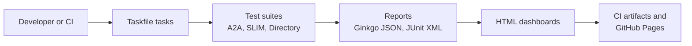

# Continuous System Integration Testing

Continuous System Integration Testing (CSIT) checks that the components of the Linux Foundation AGNTCY project work together. It tests independently released components against each other, benchmarks them, and publishes the results as dashboards. This page explains what CSIT covers, how the repository is organized, how to run each test suite locally and in GitHub Actions, and how to add a test.

!!! note "Source of Truth"

    The Taskfiles and workflows in the [csit repository](https://github.com/agntcy/csit) are the source of truth for task names, defaults, and workflow inputs. This page is maintained in the `docs/` directory of that repository. Some suites also have a deep-dive README next to the code. This page covers what each suite does and how to run it, and the deep-dive covers internals and troubleshooting.

## What CSIT Covers

CSIT does the following:

- Checks that the Agent2Agent (A2A) SDKs for Go, Rust, Python, and .NET interoperate across transports, and that A2A over SLIM remote procedure call (SLIMRPC) works across Go, Python, .NET, Java, and Node.
- Tests the [Secure Low-Latency Interactive Messaging (SLIM)]([[ agntcy.slim_url ]]) data plane, control plane, and topologies on Kubernetes.
- Checks that [Agent Directory Service]([[ agntcy.dir_url ]]) clients and servers conform across released versions.
- Benchmarks SLIM and compares messaging approaches.
- Turns test results into a static evidence dashboard.

[Taskfile](https://taskfile.dev/) tasks drive every suite, and most tests are [Ginkgo](https://onsi.github.io/ginkgo/) (Go) specs. The same task names run locally and in GitHub Actions.



## Repository Layout

```text
csit
├── Taskfile.yml                      # Root tasks; includes integrations/ and benchmarks/
├── integrations/                     # Integration, interoperability, and conformance suites
│   ├── Taskfile.yml                  # Includes every suite below; kind:create, kind:destroy, version
│   ├── agntcy-a2a/                   # A2A SDK interoperability (Rust/Go/Python/.NET)
│   ├── agntcy-a2a-slimrpc/           # A2A over SLIMRPC interoperability (Go/Python/.NET/Java/Node)
│   ├── agntcy-slim/
│   │   ├── topology/                 # Control-plane managed SLIM topology test (Kind)
│   │   └── agent-consensus-test/     # P2P vs SLIM group multicast consensus comparison
│   ├── agntcy-dir/                   # Directory (agntcy/dir) conformance
│   │   ├── components/               # Helm values and bootstrap config for Directory
│   │   ├── examples/                 # Directory e2e testdata
│   │   ├── manifests/
│   │   └── tests/conformance/        # Client/server version matrix
│   ├── testutils/                    # Go test helpers (k8shelper, runner)
│   ├── go.mod
│   └── go.sum
├── benchmarks/                       # Benchmarks
│   ├── Taskfile.yml
│   ├── agntcy-slim/                  # SLIM benchmark suite
│   ├── agntcy-dir/                   # Directory benchmarks (placeholder spec)
│   ├── go.mod
│   └── go.sum
├── kind-slim-multi-host/             # Two Kind clusters + ingress + SLIM (own Taskfile)
├── analitics/                        # Agentic evidence dashboard (own Taskfile and Go module)
├── docs/                             # Documentation and design plans
└── .github/
    ├── workflows/                    # One test-<suite>.yaml workflow per suite
    ├── actions/                      # Composite actions (setup-env, detect-suite-changes, ...)
    └── scripts/                      # Pages and landing page helpers
```

Each component owns the tasks it needs in its own Taskfile, and higher-level Taskfiles include lower-level ones, so you can run any task from the repository root.

## Task System

The root [`Taskfile.yml`](https://github.com/agntcy/csit/blob/main/Taskfile.yml) includes the following Taskfiles:

| Include Prefix | Taskfile | Working Directory |
| --- | --- | --- |
| `integrations:` | [`integrations/Taskfile.yml`](https://github.com/agntcy/csit/blob/main/integrations/Taskfile.yml) | `integrations/` |
| `benchmarks:` | [`benchmarks/Taskfile.yml`](https://github.com/agntcy/csit/blob/main/benchmarks/Taskfile.yml) | `benchmarks/` |

`integrations/Taskfile.yml` in turn includes the suites:

| Prefix (After `integrations:`) | Suite Taskfile |
| --- | --- |
| `a2a:` | `agntcy-a2a/Taskfile.yml` |
| `a2a-slimrpc:` | `agntcy-a2a-slimrpc/Taskfile.yml` |
| `slim:` | `agntcy-slim/topology/Taskfile.yml` |
| `slim-agent-consensus:` | `agntcy-slim/agent-consensus-test/Taskfile.yml` |
| `directory:` | `agntcy-dir/Taskfile.yml` |

It also defines the shared cluster helpers `kind:create` and `kind:destroy` (the cluster name comes from `KIND_CLUSTER_NAME`, which defaults to `agntcy-test`) and the `version` task.

The `kind-slim-multi-host/` and `analitics/` directories are not included in the root Taskfile. Run them from their own directory or with `task -t <path>/Taskfile.yml`.

### Listing Tasks

```bash
task -l      # tasks that have a description
task         # same, because the default task is `task -l`
task -a      # list all tasks, including those without a description
```

These are representative entries. The full list is long, so run `task -l` to see it.

```text
benchmarks:slim:benchmark:suite                       Run the local SLIM benchmark suite with reproducible defaults and optional overrides
benchmarks:slim:benchmark:ci:suite-smoke              Bounded CI-safe smoke suite
benchmarks:slim:test                                  All Slim benchmark test
integrations:a2a:test                                 Default A2A interoperability tests
integrations:a2a:test:behavior:*                      Shared behavior slice task
integrations:a2a:test:rust-go:*:*                     Rust and Go per-case task
integrations:a2a-slimrpc:test                         A2A over SLIMRPC interop (full 5×5) - requires a running SLIM node
integrations:slim:test:topology:setup                 One-shot setup (slimctl, client image, controller, clusters)
integrations:slim:test:topology:run                   Slim topology test
integrations:slim:test:topology:report                Render HTML dashboard from topology test Ginkgo JSON report
integrations:slim-agent-consensus:compare:suite       Run default consensus scenarios on P2P and SLIM
integrations:kind:create                              Create kind cluster
integrations:kind:destroy                             Destroy kind cluster
integrations:version                                  Get version
```

Wildcard-backed task families, such as the A2A matrix, are listed with `*` to keep the listing compact. Concrete invocations such as `task integrations:a2a:test:rust-go:jsonrpc:go-go` work as written.

### Task Naming

From the repository root, you address a task as `<include prefix>:<suite prefix>:<task in suite Taskfile>`. For example, the task `test:rust-go` defined in `integrations/agntcy-a2a/Taskfile.yml` is `integrations:a2a:test:rust-go` from the root. Inside the suite directory, you can use the short name (`task test:rust-go`).

## Prerequisites

Install only what the suite you want to run needs.

| Suite | Required Tools |
| --- | --- |
| All | [Taskfile](https://taskfile.dev/installation/) and [Go](https://go.dev/doc/install). The `go.mod` files declare Go 1.25.0, and some suites need a newer version, as listed in this table. |
| A2A interoperability | [Rust and Cargo](https://www.rust-lang.org/tools/install) for the Rust slices, [uv](https://docs.astral.sh/uv/) and Python 3.11 or later for the Python slices, and the .NET 8 SDK for the .NET slices. No Kind cluster, Helm, or sibling checkouts are needed. `task integrations:a2a:test` runs every slice, so it needs all of these tools. |
| A2A over SLIMRPC | A running SLIM node (Docker is the simplest option), Go 1.26.0 or later, Python 3.10 or later, the .NET 8 SDK, JDK 21, and Node.js 18 or later. You can skip any language with the variables described in that suite's section. |
| SLIM topology | Docker, [Kind](https://kind.sigs.k8s.io/docs/user/quick-start#installation), [kubectl](https://kubernetes.io/docs/tasks/tools/#kubectl), [Helm](https://helm.sh/docs/intro/install/), and Go. Access to GitHub Container Registry (GHCR) for SLIM images and charts. |
| SLIM multi-cluster stack | Docker, Kind, kubectl, Helm, Go, `jq`, `dig`, and GHCR access. |
| SLIM agent consensus | Go and `slimctl`, which a task downloads for you. |
| SLIM benchmarks | Go, and `slimctl` in your `PATH` (or run `task benchmarks:slim:deps:slimctl-download`). |
| Directory conformance | Docker, Go (the suite's temporary Go module declares Go 1.26.2), and GHCR access. |
| Agentic evidence dashboard | Go, `jq`, `bash`, `slimctl` (or run `task -t analitics/Taskfile.yml deps:slimctl-download`), and the native SLIM bindings. |

## Test Suites

Some suites are self-contained and run directly on your host. Others deploy components on Kubernetes and need a Kind cluster first. Each section below says which.

### A2A Interoperability

- Location: [`integrations/agntcy-a2a`](https://github.com/agntcy/csit/tree/main/integrations/agntcy-a2a)
- Deep dive: [`integrations/agntcy-a2a/README.md`](https://github.com/agntcy/csit/blob/main/integrations/agntcy-a2a/README.md), which has the full leg and behavior coverage tables, fixture details, and how shared behaviors are wired
- Environment: self-contained, host only. The suite builds and runs small Go, Rust, .NET, and Python fixtures locally.

These are cross-SDK checks of A2A behavior. The suite writes each behavior assertion once as a shared Ginkgo behavior and expands it across client/server transport matrices. The language-specific parts live behind Go, Rust, .NET, and Python launchers or probes.

| SDK Pair | JSON-RPC | HTTP+JSON | gRPC | Root Task |
| --- | --- | --- | --- | --- |
| Rust/Go | Yes | Yes | Yes | `task integrations:a2a:test:rust-go` |
| Rust/.NET | Yes | Yes | No | `task integrations:a2a:test:rust-dotnet` |
| Go/.NET | Yes | Yes | No | `task integrations:a2a:test:go-dotnet` |
| Python/Go | Yes | Yes | Yes | `task integrations:a2a:test:python-go` |
| Rust/Python | Yes | Yes | Yes | `task integrations:a2a:test:rust-python` |
| Python/.NET | Yes | Yes | No | `task integrations:a2a:test:python-dotnet` |

Each pair covers all client/server combinations of its two SDKs. For example, Rust/Go covers `go-go`, `go-rust`, `rust-go`, and `rust-rust`. In addition, `self-go`, `self-rust`, `self-python`, and `self-dotnet` check each SDK against itself. `task integrations:a2a:test` runs the four self suites and the six pair suites.

!!! warning "Check the Reports"

    `task integrations:a2a:test` continues when a suite fails, because the Taskfile uses `ignore_error`. Check the reports, not only the exit code.

The matrix validates these behaviors:

- Unary and streaming `SendMessage`
- Message-only responses
- Task lifecycle (`GetTask`, `ListTasks`, and `CancelTask`)
- Failed tasks
- Multi-turn `TASK_STATE_INPUT_REQUIRED`
- Long-running completion
- Artifact-rich streaming
- Extended agent card discovery
- Negative-path errors
- Push-config CRUD

.NET servers return the "unsupported" error for push-config, and the suite expects it.

Run the suite from the repository root. From `integrations/agntcy-a2a/`, drop the `integrations:a2a:` prefix.

```bash
# Whole default matrix
task integrations:a2a:test

# One SDK pair
task integrations:a2a:test:rust-go
task integrations:a2a:test:python-dotnet

# One transport of a pair: <jsonrpc|rest|grpc>
task integrations:a2a:test:rust-go:jsonrpc
task integrations:a2a:test:python-go:grpc

# One client->server case of a transport
task integrations:a2a:test:rust-go:jsonrpc:go-go
task integrations:a2a:test:rust-python:jsonrpc:python-rust

# Behavior slices across all pairs, or within one pair
task integrations:a2a:test:behavior:core
task integrations:a2a:test:rust-go:behavior:lifecycle

# Self-compatibility
task integrations:a2a:test:self
task integrations:a2a:test:self-go
```

Task names follow these forms:

| Form | Meaning |
| --- | --- |
| `test:<pair>` | Full pair suite |
| `test:<pair>:<transport>` | One transport (`jsonrpc`, `rest`, or `grpc`; `grpc` only where covered) |
| `test:<pair>:<transport>:<client>-<server>` | One case, for example `go-rust` |
| `test:behavior:<slice>` | A behavior slice across suites |
| `test:<pair>:behavior:<slice>` | A behavior slice within one pair |

Behavior slices are `core`, `task-streaming`, `lifecycle`, `push-config`, and `parity`. They map to the Ginkgo labels `behavior-core`, `behavior-task-streaming`, `behavior-lifecycle`, `behavior-push-config`, and `behavior-parity`. For the Rust/.NET pair, the canonical case name is `rust-rust-dotnet`, and `rust-rust` is kept as an alias.

Other tasks:

| Task | Purpose |
| --- | --- |
| `integrations:a2a:reports:dashboard` | Rebuild the HTML dashboard from existing raw reports |
| `integrations:a2a:deps:update` | Update all SDK dependencies (also `:go`, `:rust`, `:python`, and `:dotnet`) |

The .NET slices build their fixtures from the published `A2A` and `A2A.AspNetCore` NuGet packages at test time. The Python slices run `uv sync` in `fixtures/python`, which installs `a2a-sdk` (version 1.0.0 or later, locked in `uv.lock`) and needs Python 3.11 or later. Set `UV` to the `uv` binary if it isn't on your `PATH`.

The suite writes reports to `integrations/agntcy-a2a/reports/` (Ginkgo JSON, JUnit XML, and `index.html`) and refreshes the dashboard after each run.

### A2A over SLIMRPC Interoperability

- Location: [`integrations/agntcy-a2a-slimrpc`](https://github.com/agntcy/csit/tree/main/integrations/agntcy-a2a-slimrpc)
- Deep dive: [`integrations/agntcy-a2a-slimrpc/README.md`](https://github.com/agntcy/csit/blob/main/integrations/agntcy-a2a-slimrpc/README.md), which covers environment variables, the `slim` `main` dev mode, troubleshooting, and pinned versions
- Environment: host, plus a running SLIM node.

This suite checks that A2A over SLIMRPC behaves the same across Go, Python, .NET, Java, and Node. It exercises every client/server language pair (a five-by-five matrix, 25 pairs). The behaviors per pair are `echo`, `lifecycle`, `message-only`, `task-failure`, `input-required`, `streaming`, `task-cancel`, and `multi-turn`. The suite is separate from the A2A suite above (JSON-RPC, REST, and gRPC) and from the SLIM topology suite (Kubernetes).

The baseline is a pinned, released SLIM node image. The suite Taskfile defines the pin (`SLIM_IMAGE`, `SLIM_RELEASE`, and `SLIM_BINDINGS_RELEASE`). Print it with `task integrations:a2a-slimrpc:versions`.

```bash
# 1) Start the pinned released SLIM node (check `versions` for the current image tag)
docker run -d --name slim-node -p 46357:46357 \
  -v "$PWD/integrations/agntcy-a2a-slimrpc/ci/slim-server-config.yaml:/config.yaml:ro" \
  ghcr.io/agntcy/slim:3.4.1 /slim --config /config.yaml

# 2) Run all 25 pairs
task integrations:a2a-slimrpc:test

# Or one pair: <client>-<server> with languages go|python|dotnet|java|node
task integrations:a2a-slimrpc:test:go-node
```

Useful environment variables:

| Variable | Effect |
| --- | --- |
| `SLIM_SERVER` | SLIM endpoint (default `http://127.0.0.1:46357`) |
| `SLIM_SHARED_SECRET` | Shared secret. It must match the node configuration. |
| `SKIP_SLIM_A2A=1` | Skip the suite, for hosts without a SLIM node. If the endpoint is unreachable and this variable is unset, the specs skip instead of failing. |
| `CSIT_SLIM_NO_DOTNET=1`, `CSIT_SLIM_NO_JAVA=1`, `CSIT_SLIM_NO_NODE=1` | Drop that language from the matrix |
| `CSIT_SLIM_GO_ONLY=1` | Run only the go-to-go spec |
| `CSIT_SLIM_STREAM_SERVER_LOGS=1` | Stream fixture server logs to the terminal (off by default) |
| `CSIT_SLIM_NATIVE_LIB` | Path to a locally built `libslim_bindings_*.a`. For development only, with a SLIM node built from `main`. |

Filter by behavior or pair with a Ginkgo label filter:

```bash
cd integrations && go test ./agntcy-a2a-slimrpc/tests -ginkgo.label-filter='behavior-lifecycle'
cd integrations && go test ./agntcy-a2a-slimrpc/tests -ginkgo.label-filter='pair-node-go'
```

The suite writes reports under `integrations/agntcy-a2a-slimrpc/reports/`. Rebuild the dashboard with `task integrations:a2a-slimrpc:reports:dashboard`. The dashboard opens with a compatibility matrix that has one row per direction and one column per behavior.

### SLIM Topology

- Location: [`integrations/agntcy-slim/topology`](https://github.com/agntcy/csit/tree/main/integrations/agntcy-slim/topology)
- Deep dive: [`TopologyTest.md`](https://github.com/agntcy/csit/blob/main/integrations/agntcy-slim/topology/TopologyTest.md), which covers the cluster config format and scenarios
- Environment: a Kind cluster, Helm, and Docker.

This suite validates control-plane managed SLIM topologies. It deploys a SLIM control plane in API mode plus several SLIM data-plane clusters. You declare the clusters in `config/clusters.yaml`. The default is `cluster-a` with one node, and `cluster-b` and `cluster-c` with two nodes each. The suite drives the inter-cluster topology (segments and links) at runtime with `slimctl` and checks message routing between point-to-point clients. Scenarios cover joining, reachability and isolation, topology changes, data-plane node restart, and control-plane restart.

```bash
task integrations:kind:create

# One-shot setup: slimctl, client image, controller, and clusters
task integrations:slim:test:topology:setup

# Run the test, then render the HTML report (optional)
task integrations:slim:test:topology:run
task integrations:slim:test:topology:report

# Tear down
task integrations:slim:test:topology:cleanup:clusters
task integrations:slim:test:topology:cleanup:controller
task integrations:kind:destroy
```

`setup` is the same as running `deps:slimctl-download`, `test:topology:build:client-image`, `test:topology:deploy:controller`, and `test:topology:deploy:clusters` in order. You can also run each of those tasks on its own. Helpers for the SPIFFE Runtime Environment (SPIRE) are available as `integrations:slim:spire:deploy` and `integrations:slim:spire:remove`.

Image and chart versions are task variables that you can override: `TOPOLOGY_SLIM_IMAGE_TAG`, `TOPOLOGY_SLIM_CHART_TAG`, `TOPOLOGY_SLIM_CONTROLLER_IMAGE_TAG`, `TOPOLOGY_SLIM_CONTROLLER_CHART_TAG`, `SLIM_BINDINGS_VERSION`, and `KIND_CLUSTER_NAME`. For example:

```bash
task integrations:slim:test:topology:setup \
  TOPOLOGY_SLIM_IMAGE_TAG=2.0.0 TOPOLOGY_SLIM_CHART_TAG=v2.0.0
```

!!! info "Controller Access"

    The controller Service is of type `ClusterIP`. The run task port-forwards the northbound API (`50051`) to `127.0.0.1` for the duration of the test, so you don't need a load balancer provider. See `TopologyTest.md` for details.

The suite writes reports to `integrations/agntcy-slim/topology/reports/`: `report-slim-topology.json` and `.xml`, `index.html`, and the `c2-evidence.json` file that the [agentic evidence dashboard](#agentic-evidence-dashboard) reads.

### SLIM Multi-Cluster Stack

- Location: [`kind-slim-multi-host`](https://github.com/agntcy/csit/tree/main/kind-slim-multi-host)
- Deep dive: [`kind-slim-multi-host/README.md`](https://github.com/agntcy/csit/blob/main/kind-slim-multi-host/README.md), which covers the architecture, the DNS helper, host `slimctl` access, and limitations
- Environment: two Kind clusters, Helm, and Docker. Run it from the `kind-slim-multi-host` directory, which has its own Taskfile.

This stack creates two Kind clusters (`csit-a` and `csit-b`). Cluster A runs ingress-nginx behind a cloud-provider-kind LoadBalancer. Cluster B uses patched CoreDNS, and a local DNS helper resolves `*.csit.test`. The stack runs SLIM (data plane and controller) from the published GHCR charts and images.

```bash
cd kind-slim-multi-host
task prereq
task stack:up        # clusters + ingress + SLIM + DNS, verified at the end
task stack:down      # uninstall everything and delete the clusters
```

Other entry points are `task cluster:up` and `task cluster:teardown` (clusters only) and `task stack:install` (on existing clusters). You can override chart and image versions and many other settings through environment variables such as `SLIM_IMAGE_TAG`, `CTRL_IMAGE_TAG`, `SLIM_CHART_VERSION`, `CTRL_CHART_VERSION`, `SLIMCTL_VERSION`, and `CSIT_LOCAL_DNS_HOST_PORT`. The deep-dive README lists them all.

### SLIM Agent Consensus

- Location: [`integrations/agntcy-slim/agent-consensus-test`](https://github.com/agntcy/csit/tree/main/integrations/agntcy-slim/agent-consensus-test)
- Deep dive: [`plans/README.md`](https://github.com/agntcy/csit/blob/main/integrations/agntcy-slim/agent-consensus-test/plans/README.md), which covers the scenario schema and sweep generation
- Environment: host only. The suite starts a local SLIM stack with `slimctl`.

This is a comparative benchmark of distributed hypothesis convergence. N agents think in parallel, emit findings, and must reach identical local consensus. The suite compares two approaches:

- SLIM group multicast, where agents broadcast through the data plane and the runner only moderates.
- Peer-to-peer (P2P) streaming with a relay hub, where the runner relays every finding.

Scenarios are YAML `ConsensusScenario` files under `plans/`.

```bash
task integrations:slim-agent-consensus:deps:slimctl-download
task integrations:slim-agent-consensus:build

task integrations:slim-agent-consensus:validate:scenarios
task integrations:slim-agent-consensus:test                  # unit tests
task integrations:slim-agent-consensus:compare:suite         # default scenarios on P2P and SLIM
task integrations:slim-agent-consensus:compare:plan PLAN=<path-or-basename>
task integrations:slim-agent-consensus:compare:ci:smoke      # about two minutes
task integrations:slim-agent-consensus:compare:report        # HTML dashboard from the TSV (tab-separated values) results
```

Sweeps:

| Task | Purpose |
| --- | --- |
| `compare:sweep` | Agent, think-time, and payload sweep (`SWEEP_AGENTS`, `SWEEP_THINK_MS`, `SWEEP_PAYLOAD_BYTES`) |
| `compare:sweep:payload` | High-N, short-window, large-payload sweep |
| `compare:sweep:matrix` | Full matrix of agent counts, payload sizes, and latencies, run sequentially |
| `compare:sweep:matrix:cell` | One cell (`MATRIX_LATENCY_MS`, `MATRIX_AGENTS`, `MATRIX_PAYLOAD_BYTES`, `CONSENSUS_REPEATS`) |
| `compare:sweep:matrix:merge` | Merge per-cell TSV slices, aggregate statistics, and render the dashboard |
| `compare:matrix:report` | Render the dashboard from aggregated matrix stats |

The suite writes reports to `integrations/agntcy-slim/agent-consensus-test/reports/`.

### SLIM Benchmarks

- Location: [`benchmarks/agntcy-slim`](https://github.com/agntcy/csit/tree/main/benchmarks/agntcy-slim)
- Deep dive: [`benchmarks/agntcy-slim/README.md`](https://github.com/agntcy/csit/blob/main/benchmarks/agntcy-slim/README.md), which covers components, every environment variable, and the capacity sweep
- Environment: host only. The suite starts a local SLIM node with `slimctl`.

These are reproducible local throughput and capacity benchmarks. The workload modes are `request-reply`, `fire-and-forget`, and `write` (sender to node with no responder). Only these three names are valid mode names.

```bash
# Optional: install slimctl
task benchmarks:slim:deps:slimctl-download SLIMCTL_PATH="$HOME/.local/bin/slimctl"
export PATH="$HOME/.local/bin:$PATH"

# Full suite with stable defaults
task benchmarks:slim:benchmark:suite

# Override the matrix
task benchmarks:slim:benchmark:suite \
  BENCH_MODES='fire-and-forget write' BENCH_CLIENTS='10' \
  BENCH_SIZES='128 1024' BENCH_DURATION='2s' BENCH_REPEATS='3'

# Single workload
task benchmarks:slim:benchmark:request-reply
task benchmarks:slim:benchmark:fire-and-forget
task benchmarks:slim:benchmark:write

# Adaptive capacity sweeps (one client, 16 kB)
task benchmarks:slim:benchmark:capacity:request-reply-16kb
task benchmarks:slim:benchmark:capacity:fire-and-forget-16kb
task benchmarks:slim:benchmark:capacity:write-16kb

# Baseline throughput benchmark (reproduces the upstream agntcy/slim baseline)
task benchmarks:slim:benchmark:basic

# CI-oriented bounded profiles (25 repeats for meaningful confidence intervals)
task benchmarks:slim:benchmark:ci:suite-smoke
task benchmarks:slim:benchmark:ci:capacity
task benchmarks:slim:benchmark:ci:basic

# Local suite plus HTML dashboard
task benchmarks:slim:benchmark:report
task benchmarks:slim:reports:dashboard
```

The suite writes reports (`results.tsv`, `suite_summary.md`, `technical_report.md`, per-run raw output, and `capacity_sweep.md` for sweeps) to `benchmarks/agntcy-slim/reports/`.

`benchmarks:directory:test` runs the Directory benchmark spec in `benchmarks/agntcy-dir/tests`. It's a placeholder today: the agent push benchmark has an empty body.

### Directory Conformance

- Location: [`integrations/agntcy-dir`](https://github.com/agntcy/csit/tree/main/integrations/agntcy-dir), with tasks under `tests/conformance/`
- Environment: Docker (the suite runs servers with Docker Compose), Go, and GHCR access.

This suite runs the released [`agntcy/dir`](https://github.com/agntcy/dir) client end-to-end test package against released Directory server versions. `tests/conformance/Taskfile.yml` defines the matrix: `CONFORMANCE_SERVER_VERSIONS` is `v1.3.0` and `v1.2.0`, and `CONFORMANCE_CLIENT_VERSIONS` is `v1.3.0`. A `v1.3.0-spire` variant, which enables SPIRE, is available as an individual run.

```bash
# The whole matrix, plus an HTML summary (summary.html in the repository root)
task integrations:directory:tests:client-server:test:all

# One server/client combination
task integrations:directory:tests:client-server:test \
  SERVER_VERSION=v1.3.0 CLIENT_VERSION=v1.3.0

# The SPIRE-enabled variant
task integrations:directory:tests:client-server:test \
  SERVER_VERSION=v1.3.0-spire CLIENT_VERSION=v1.3.0-spire
```

The `test` task brings the server up (`up`), runs the client tests, and always tears the server down (`down`). It writes reports to `integrations/agntcy-dir/tests/conformance/reports/` as `Server-<server>-Client-<client>.json` and `.xml`.

!!! warning "Check the Summary"

    `test:all` ignores failures of individual combinations so that it always builds the summary. Check the summary and the reports, not only the exit code.

The conformance directory is organized by version:

- `server/<version>/` has the Taskfile (`up` and `down` tasks), the Docker Compose file, and the Directory daemon configuration for that server version. The SPIRE variant also has the SPIRE configuration templates.
- `client/<version>/test-config.yaml` configures the client tests, such as the server address and the authentication mode.

To add a version, create the matching `server/<version>/` or `client/<version>/` directory, include the new server Taskfile in the conformance Taskfile, and add the version to `CONFORMANCE_SERVER_VERSIONS` or `CONFORMANCE_CLIENT_VERSIONS`.

!!! info "Migration From the Previous Directory Tests"

    The previous Directory tests, which were maintained in CSIT, were removed. The end-to-end client tests now live in the `agntcy/dir` repository, and CSIT runs the released versions of those tests against released servers in Docker Compose. The only Directory tasks in CSIT are the conformance tasks described in this section.

### Agentic Evidence Dashboard

- Location: [`analitics`](https://github.com/agntcy/csit/tree/main/analitics), which has a Go module, templates, and scripts
- Deep dive: [`analitics/README.md`](https://github.com/agntcy/csit/blob/main/analitics/README.md). The design is in [`docs/plans`](https://github.com/agntcy/csit/tree/main/docs/plans).
- Environment: host. Run it from the repository root with `-t analitics/Taskfile.yml`.

This suite builds a static HTML dashboard organized by an agentic-system taxonomy with three classes (C1, C2, and C3). Each use case links to test-derived evidence. C1 status comes from Ginkgo specs in `analitics/tests`, and C2 status comes from the topology suite's `c2-evidence.json`. C3 status is static until its test evidence is wired in.

```bash
task -t analitics/Taskfile.yml dashboard:build        # tests + sync + render
task -t analitics/Taskfile.yml dashboard:build:only   # re-render from existing reports
task -t analitics/Taskfile.yml test:c1-evidence       # C1 specs only
task -t analitics/Taskfile.yml dashboard:clean
```

The output is in `analitics/published/` (`index.html` and `evidence/c1-evidence.{json,md,html}`).

## Shared Test Environment Helpers

- `integrations:kind:create` creates a Kind cluster (`KIND_CLUSTER_NAME`, default `agntcy-test`) and `integrations:kind:destroy` deletes it. Suites that deploy to Kubernetes build on these tasks.
- [`integrations/testutils`](https://github.com/agntcy/csit/tree/main/integrations/testutils) holds Go helpers for tests: `k8shelper` (cluster operations, pods, jobs, services, certificates, SPIRE, and log watching) and `runner` (local and Docker command runners).
- `integrations:version` prints the repository version from the latest `v*` git tag.

## Reports and Dashboards

Most suites emit Ginkgo JSON and JUnit XML reports into a `reports/` directory next to the suite and render a static HTML dashboard (`index.html`) from them:

| Suite | Report Directory | Dashboard Task |
| --- | --- | --- |
| A2A | `integrations/agntcy-a2a/reports/` | `integrations:a2a:reports:dashboard` |
| A2A over SLIMRPC | `integrations/agntcy-a2a-slimrpc/reports/` | `integrations:a2a-slimrpc:reports:dashboard` |
| SLIM topology | `integrations/agntcy-slim/topology/reports/` | `integrations:slim:test:topology:report` |
| SLIM agent consensus | `integrations/agntcy-slim/agent-consensus-test/reports/` | `integrations:slim-agent-consensus:compare:report` |
| SLIM benchmarks | `benchmarks/agntcy-slim/reports/` | `benchmarks:slim:reports:dashboard` |
| Directory conformance | `integrations/agntcy-dir/tests/conformance/reports/` | Run by `test:all` |
| Agentic evidence | `analitics/published/` | `dashboard:build` |

The SLIMRPC and Directory conformance suites share the A2A report dashboard generator (`integrations/agntcy-a2a/tools/report_dashboard.go`).

## GitHub Actions

The `task` commands above run on your machine. CI runs the same tasks on GitHub-hosted runners.

### Workflows

| Workflow | Suite | Triggers | Manual Inputs |
| --- | --- | --- | --- |
| [`test-a2a`](https://github.com/agntcy/csit/blob/main/.github/workflows/test-a2a.yaml) | A2A interoperability, one matrix job per pair plus the four self suites | Push to `main`, pull request, manual | None |
| [`test-a2a-slimrpc`](https://github.com/agntcy/csit/blob/main/.github/workflows/test-a2a-slimrpc.yaml) | A2A over SLIMRPC, one matrix job per client/server pair against the pinned SLIM node | Push to `main`, pull request, manual | None |
| [`test-slim-integration`](https://github.com/agntcy/csit/blob/main/.github/workflows/test-slim-integration.yaml) | SLIM topology. It creates its own Kind cluster. | Push to `main`, pull request, manual | `kind_version` (default `0.24.0`), `override_slim_image_tag`, `override_slim_chart_tag`, `override_slim_controller_image_tag`, `override_slim_controller_chart_tag`, `override_slim_bindings_version` |
| [`test-slim-multicluster-private`](https://github.com/agntcy/csit/blob/main/.github/workflows/test-slim-multicluster-private.yaml) | SLIM multi-cluster Kind stack | Push to `main`, pull request, manual | `override_slim_image_tag`, `override_slim_controller_image_tag`, `override_slim_chart_version`, `override_slim_control_plane_chart_version`, `override_slim_spire_chart_version`, `slimctl_version` (default `1.4.0`) |
| [`test-slim-benchmarks`](https://github.com/agntcy/csit/blob/main/.github/workflows/test-slim-benchmarks.yaml) | SLIM benchmark smoke, basic, and capacity jobs | Push to `main`, pull request, manual | `run_capacity` (boolean, default `false`). On manual dispatch, the capacity job runs only when it is `true`. Push and pull request runs always include it. |
| [`test-slim-agent-consensus`](https://github.com/agntcy/csit/blob/main/.github/workflows/test-slim-agent-consensus.yaml) | SLIM agent consensus matrix (one job per latency, agent count, and payload cell, then a merge job) | Manual only | `repeats` (default `25`) |
| [`test-directory-conformance`](https://github.com/agntcy/csit/blob/main/.github/workflows/test-directory-conformance.yaml) | Directory conformance | Push to `main`, pull request, manual | `override_directory_image_tag`, `override_directory_chart_tag` |
| [`test-agentic-evidence`](https://github.com/agntcy/csit/blob/main/.github/workflows/test-agentic-evidence.yaml) | Agentic evidence dashboard | Push to `main`, pull request, manual | None |
| [`reusable-docker-build-push`](https://github.com/agntcy/csit/blob/main/.github/workflows/reusable-docker-build-push.yaml) | Reusable image build and push (`workflow_call`). Nothing in the repository calls it today. | Called from other workflows | See the file |
| [`release-please-check`](https://github.com/agntcy/csit/blob/main/.github/workflows/release-please-check.yaml) | Release automation (release-please) | Push to `main` | None |
| [`test-remote-workflow-dispatch`](https://github.com/agntcy/csit/blob/main/.github/workflows/test-remote-workflow-dispatch.yaml) | Dispatches `test-integrations.yaml` on the `feat/gh-action-repository-dispatch` ref of `agntcy/csit`. Neither exists in the repository today, so treat this workflow as a stale helper. | Manual | None |

Optional override inputs default to empty strings, which leave the defaults in the Taskfiles in effect. For `test-slim-integration`, empty controller image and chart overrides fall back to `override_slim_image_tag` and `override_slim_chart_tag`. No workflow accepts a `testenv` input.

Common building blocks live in [`.github/actions`](https://github.com/agntcy/csit/tree/main/.github/actions): `setup-env` (Go, Python and uv, .NET, and others), `setup-k8s` (Kind, kubectl, and Helm), `detect-suite-changes`, `create-artifact`, `collect-reports`, and `publish-test-reports-pages`.

### Path-Based Gating

On push and pull requests, the suite workflows first run a `detect` job (`detect-suite-changes`) and run their tests only if files for that suite changed. The exception is `test-slim-agent-consensus`, which is manual only.

| Suite ID | Paths That Trigger It |
| --- | --- |
| `a2a` | `integrations/agntcy-a2a/**` and its workflow |
| `a2a-slimrpc` | `integrations/agntcy-a2a-slimrpc/**` and its workflow |
| `slim-integration` | `integrations/agntcy-slim/**` and its workflow |
| `directory-conformance` | `integrations/agntcy-dir/**` and its workflow |
| `slim-benchmarks` | `benchmarks/agntcy-slim/**`, `benchmarks/Taskfile.yml`, and its workflow |
| `slim-multicluster-private` | `kind-slim-multi-host/**` and its workflow |
| `agentic-evidence` | `analitics/**` and its workflow |

Changes to shared files run every suite. The shared files are the root, `integrations/`, and `benchmarks/` Taskfiles, and the `setup-env`, `setup-go`, `setup-python`, `setup-k8s`, `deploy-components`, `create-artifact`, `collect-reports`, and `detect-suite-changes` actions. A manual dispatch always runs the tests.

### Running a Workflow Manually

Manual dispatch has these requirements:

- GitHub Actions is enabled on the target repository.
- You are authenticated with an account that has write access to that repository. Use `agntcy/csit` only if you have that access. Otherwise, run the suite locally or use your fork with Actions enabled.
- The workflow supports `workflow_dispatch` on the repository's default branch and on the selected branch.

`gh workflow run` dispatches a workflow from a remote branch. The `--ref` option selects remote code and doesn't upload local changes. In the examples, replace `OWNER/csit` with the repository where you can dispatch.

Run A2A on the default branch:

```bash
gh workflow run test-a2a.yaml --repo OWNER/csit
```

Run the SLIM topology test on a branch with explicit versions:

```bash
gh workflow run test-slim-integration.yaml --repo OWNER/csit --ref BRANCH \
  -f kind_version=0.24.0 \
  -f override_slim_image_tag=2.0.0 \
  -f override_slim_chart_tag=v2.0.0 \
  -f override_slim_bindings_version=2.0.0
```

In the GitHub web UI, open **Actions**, select the workflow, then choose **Run workflow**, the branch, and any supported inputs.

Find the dispatched run and inspect its logs, replacing `RUN_ID` with its run ID:

```bash
gh run list --repo OWNER/csit --workflow test-slim-integration.yaml \
  --branch BRANCH --event workflow_dispatch
gh run view RUN_ID --repo OWNER/csit --log
```

### Reports and Artifacts

Open the run's summary and **Artifacts** section in the web UI, or download the artifacts with `gh run download`:

| Workflow | Artifact Name | Contents |
| --- | --- | --- |
| `test-a2a` | `a2a-interop-test-result-<matrix-id>`, for example `a2a-interop-test-result-rust-go` or `a2a-interop-test-result-self-go` | `integrations/agntcy-a2a/reports/` |
| `test-a2a-slimrpc` | `a2a-slimrpc-test-result-<client>-<server>` | `integrations/agntcy-a2a-slimrpc/reports/` |
| `test-slim-integration` | `slim-integration-test-result` | `integrations/agntcy-slim/topology/reports/` |
| `test-slim-multicluster-private` | `slim-multicluster-private-test-result` | `integrations/agntcy-slim/multicluster-private/reports/`, which holds a `summary.html` that the workflow writes at run time |
| `test-slim-benchmarks` | `slim-benchmark-smoke-report`, `slim-benchmark-basic-report`, `slim-benchmark-capacity-report` | `benchmarks/agntcy-slim/published/smoke`, `benchmarks/agntcy-slim/published/basic`, and `benchmarks/agntcy-slim/published/capacity` |
| `test-slim-agent-consensus` | `slim-agent-consensus-matrix-lat<ms>-<agents>ag-<bytes>b` (per cell) and `slim-agent-consensus-report` (merged) | TSV slices, plus the merged reports and dashboard |
| `test-directory-conformance` | `directory-conformance-test-result` | `summary.html` only, which is the HTML summary of all conformance runs |
| `test-agentic-evidence` | `agentic-evidence-dashboard` | `analitics/published/` |

For example, download the SLIM topology reports with:

```bash
gh run download RUN_ID --repo OWNER/csit --name slim-integration-test-result \
  --dir ./reports/slim-integration
```

If a job fails before it generates or uploads reports, check its logs instead.

### GitHub Pages

Each suite workflow has a `publish-pages` job. It runs only on `main`, downloads the run's artifacts, and publishes the dashboards and a landing page to the `gh-pages` branch (`docs/index.html`, `docs/a2a/`, `docs/directory/`, and others). Use the run artifacts for feature-branch results.

## Adding a Test

1. Fork and clone the repository, then create a branch:

    ```bash
    git clone https://github.com/your-username/csit.git
    cd csit
    git checkout -b add-new-test
    ```

1. Pick the right place. Extend an existing suite when possible. For interoperability behaviors, see the A2A suite's [How to Add a Test](https://github.com/agntcy/csit/blob/main/integrations/agntcy-a2a/README.md#how-to-add-a-test). You add the behavior once in the shared layer, and the suite expands it across the whole matrix. For a new component, create a sub-directory under `integrations/` (for example, `integrations/new-component`) that follows the existing structure, with scripts, manifests, configuration, and tests.

1. Wire it into the Taskfiles. Add tasks to the suite's `Taskfile.yml` for deploying, running, and cleaning up your test. Add a new suite Taskfile to `includes` in [`integrations/Taskfile.yml`](https://github.com/agntcy/csit/blob/main/integrations/Taskfile.yml) so you can reach it from the repository root.

    ```yaml
    tasks:
      test:env:new-component:deploy:
        desc: Deploy new component elements
        cmds:
          - # Command for deploying your components if needed

      test:env:new-component:cleanup:
        desc: Clean up component elements
        cmds:
          - # Command for cleaning up your components if needed

      test:new-component:
        desc: Run the new component test
        cmds:
          - # Commands to set up and run your test
    ```

1. Wire it into CI. Reuse the existing suite workflow instead of creating a new workflow for each test:

    - For an existing suite, extend its tasks and configuration. For example, the SLIM workflow calls `integrations:slim:test:topology:setup`, `...:run`, and `...:report` from the repository root, so add topology cases and configuration to that suite.
    - For a test with its own Taskfile, include it through the existing `includes` and add the task invocation and any configuration to the corresponding workflow.
    - For a new suite with its own workflow, register its paths in [`detect-suite-changes`](https://github.com/agntcy/csit/blob/main/.github/actions/detect-suite-changes/action.yaml) and its artifacts in [`publish-test-reports-pages`](https://github.com/agntcy/csit/blob/main/.github/actions/publish-test-reports-pages/action.yaml).
    - Keep reports in the suite's configured artifact directory so the upload step can collect them.

1. Test locally before you push. For a suite that needs Kubernetes:

    ```bash
    task integrations:kind:create
    task integrations:<suite>:test:env:new-component:deploy
    task integrations:<suite>:test:new-component
    task integrations:<suite>:test:env:new-component:cleanup
    task integrations:kind:destroy
    ```

    Run the narrowest task that exercises your change first, then the broader suite.

1. Document it. Add or update the suite's section in the CSIT documentation in the `docs/` directory of the csit repository, which is the source of this page. Include the suite's purpose, special setup, the tasks that run it, where reports go, and the CI workflow. If the suite has a deep-dive README, link to it.

1. Commit, push, and open a pull request. Commits need a sign-off (see [CONTRIBUTING](https://github.com/agntcy/csit/blob/main/CONTRIBUTING.md)):

    ```bash
    git add .
    git commit -s -m "feat: add new test for component X"
    git push origin add-new-test
    ```

    Open a pull request from your branch with a description of what the test covers and any context reviewers need.

## Updating the Directory Test Data

To update `integrations/agntcy-dir/examples/dir/e2e/testdata`, add `agntcy/dir` as a remote and apply a patch generated by diffing against the `agntcy/dir` repository:

```bash
# add agntcy/dir as remote
git remote add -f dir https://github.com/agntcy/dir.git
# fetch dir
git fetch dir
# example of updating integrations/agntcy-dir/examples/dir/e2e/testdata to agntcy/dir main
git diff --binary HEAD:integrations/agntcy-dir/examples/dir/e2e/testdata dir/main:e2e/testdata | git apply --directory=integrations/agntcy-dir/examples/dir/e2e/testdata
```

## Learn More

- [Contributing guidelines](https://github.com/agntcy/csit/blob/main/CONTRIBUTING.md), [Code of Conduct](https://github.com/agntcy/csit/blob/main/CODE_OF_CONDUCT.md), and [Security policy](https://github.com/agntcy/csit/blob/main/SECURITY.md)
- Design plans in [`docs/plans/`](https://github.com/agntcy/csit/tree/main/docs/plans), which cover multi-cluster SLIM infrastructure, the SLIM dashboard epic, and the C1 and C2 evidence contracts
- [`context/context.md`](https://github.com/agntcy/csit/blob/main/context/context.md), which has historical hand-off notes for the SLIMRPC suite
- [License](https://github.com/agntcy/csit/blob/main/LICENSE.md): Apache 2.0, Copyright AGNTCY Contributors
